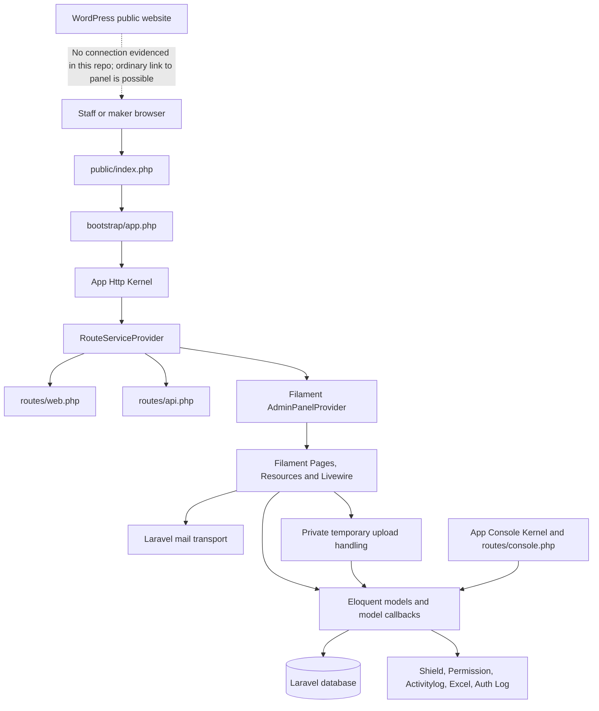
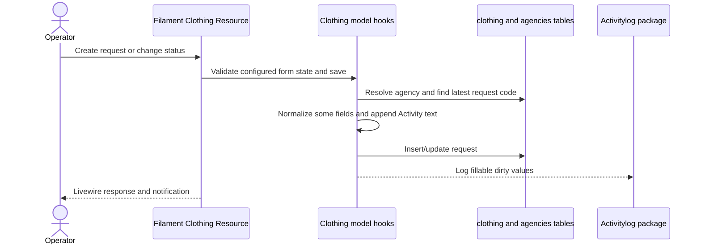
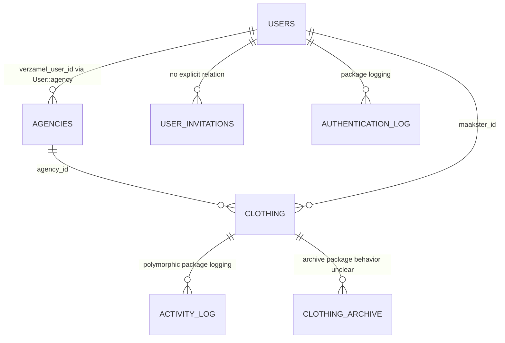

# TFFK architecture map

Audit date: 2026-10-16. The diagrams represent source structure and declared wiring, not a runtime trace.

## Component map

## HTTP request and response flow

1. Standard Laravel front controller starts the application through `bootstrap/app.php`, which binds `App\Http\Kernel`, `App\Console\Kernel` and `App\Exceptions\Handler`.
2. `App\Http\Kernel` applies `TrustProxies`, CORS, maintenance mode, post-size validation and input normalization globally (`app/Http/Kernel.php:25-35`). The web group creates/encrypts sessions, applies CSRF and route binding; API group applies throttling and binding (`:43-62`).
3. `RouteServiceProvider` mounts API routes under `/api` and web routes with their middleware (`app/Providers/RouteServiceProvider.php:27-37`). Web routes explicitly define only signed `/register`; Filament package routes come from the panel provider. API has Sanctum-protected `/user` only.
4. Filament routes resolve resources/pages to Livewire components. The single default panel is ID `admin`, URL path empty, and enables login/profile/password reset (`app/Providers/Filament/AdminPanelProvider.php:30-38`).
5. Panel middleware includes session, CSRF, bindings, Filament rendering and `LogSuccessfulLogin`; auth middleware is Filament's `Authenticate` (`:49-65`). `User::canAccessPanel()` only checks `active`.
6. Filament schema callbacks/actions mutate Eloquent records. `Clothing` model hooks generate request codes, normalize some fields and append actor/status text (`app/Models/Clothing.php:194-242`). Activitylog separately records fillable dirty fields.
7. Filament returns a Livewire component response and notifications. Exports generate files through package actions; invitation mail sends synchronously through Laravel's mail facade.

Items 1–7 describe configured code; actual middleware ordering/route generation/package behavior and target DB are not dynamically confirmed.

## Layering and boundaries

| Concern | Current location | Observation |
| --- | --- | --- |
| HTTP routing | `routes/`, `RouteServiceProvider` | Minimal custom routes; most UI routes generated by Filament. |
| Authentication | Laravel session guard, Filament auth, `User` | Web session guard; Sanctum installed but little API usage. |
| Authorization | `AuthServiceProvider`, `Policies`, Shield, resource callbacks/query scopes | Overlapping mechanisms; difficult to review as a single permission matrix. |
| UI and orchestration | `app/Filament/Resources`, pages, actions, `app/Livewire` | Most workflow coordination and some DB mutation live in UI classes. |
| Domain/data rules | `app/Models/Clothing`, `Agency`, subclasses | Model hooks contain identifier generation and status side effects. No clear service/domain boundary. |
| Persistence | Eloquent and `database/migrations` | One main clothing table, plus package and account tables; schema legacy and weakly constrained in areas. |
| Integration | `app/Mail`, import/export package config | Invitation email and Excel workflows are visible; no WordPress/API client or webhook. |
| Background processing | `app/Console/Kernel`, queue config | Empty app schedule, no app job classes; queue default `sync`. |
| Static assets | Vite, Tailwind, Blade and Livewire views | `npm run build`/`dev` scripts declared; deployment workflow does not run npm build. |

## Data flow: clothing request

This flow lacks a visible transaction around next-code lookup/insertion and database uniqueness on `Code`. Status writes can occur via multiple UI callbacks, with `setStatus()` side effects in some paths and direct status writes in others.

## Data model relationships

`Agency::verzamel_user()` omits the explicit `verzamel_user_id` key although that is the field used by `User::agency()` and collector resource filtering. Most `Clothing` foreign IDs other than `agency_id` have no migration FK. `Creator`, `Collector`, `Offer`, `Completed`, `Confirm`, `Management` and `CreatorHistory` are model subclasses sharing the same `clothing` table, which is workflow-role modeling rather than separate persisted entities.

## Hidden side effects and duplication

- `Clothing::creating` queries for the previous `Code`, sets default status, normalizes gender/age, and reads `auth()->user()` to store actor and free-text activity (`Clothing.php:194-236`). Non-HTTP callers may not have a user.
- `Clothing::updating` appends status changes to free-text `Activity`; Spatie Activitylog also logs dirty fillable values (`:173-176,238-242`), creating overlapping audit trails.
- Several resources duplicate status options, address rendering and exports. The agency report repeats twelve monthly count definitions.
- `Clothing::afterStateUpdated` callbacks save records while a form is being edited and then dispatch refresh events; intermediate state may be persisted before the rest of the form.
- `LogSuccessfulLogin` writes a timestamp on every authenticated panel request, not only an authentication event.
- Invitation email is synchronous; mail failure may interrupt action feedback depending on transport behavior.

## WordPress boundary

WordPress is a separate external application. No API/webhook/data sync link is in this Laravel source. A WordPress button can link to the root panel's expected `/login` path at the backend host. No common login session or SSO should be assumed. See [TFFK_INTEGRATIONS.md](TFFK_INTEGRATIONS.md).
